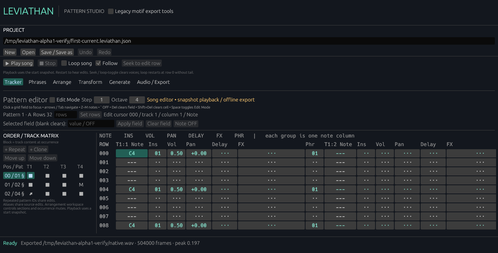
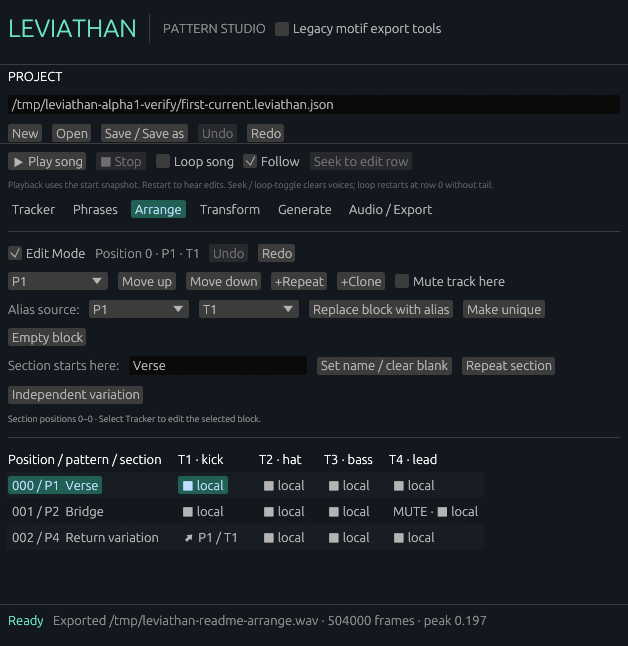
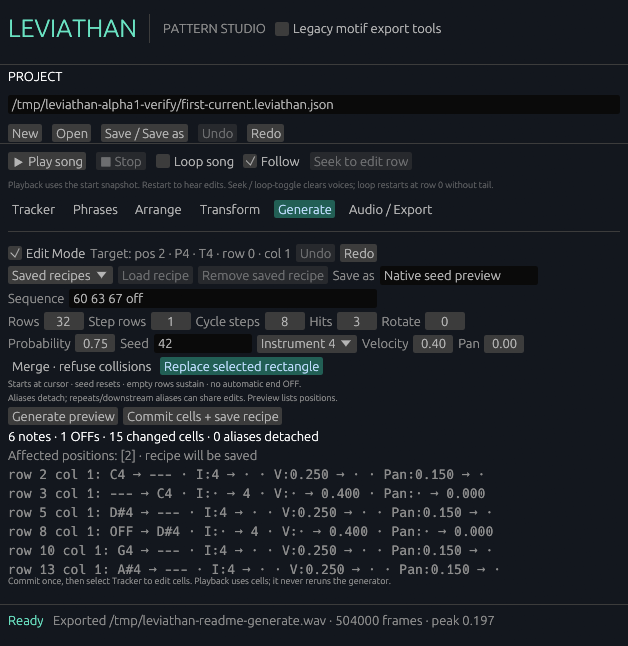

<div align="center">

# LEVIATHAN

### Agent-first music creation. No MCP needed.

A native Rust tracker and sampler for editable patterns, waveform regions, break slicing, phrases, and seeded generation.

[](https://github.com/meatproxy69/Leviathan/releases/tag/v0.1.0-alpha.2)
[](https://github.com/meatproxy69/Leviathan/releases/download/v0.1.0-alpha.2/leviathan-v0.1.0-alpha.2-windows-x86_64.zip)
[](https://github.com/meatproxy69/Leviathan/releases/download/v0.1.0-alpha.2/leviathan-v0.1.0-alpha.2-linux-x86_64.tar.gz)
[](LICENSE)

**[Download for Windows](https://github.com/meatproxy69/Leviathan/releases/download/v0.1.0-alpha.2/leviathan-v0.1.0-alpha.2-windows-x86_64.zip)** · **[Download for Linux](https://github.com/meatproxy69/Leviathan/releases/download/v0.1.0-alpha.2/leviathan-v0.1.0-alpha.2-linux-x86_64.tar.gz)** · **[Build from source](#build-from-source)** · **[Try a demo](#try-a-song-in-three-commands)** · **[Agent workflow](#agent-first-no-mcp-required)**



*Real Alpha 1 screenshots with locally generated synthetic tones.*

</div>

## Make patterns. Shape a song.

Write notes directly in the tracker, shape samples in the waveform editor, and
turn breaks into editable patterns. Review slice markers, map regions to pads,
and preview groove or seeded generation before committing ordinary notes.
Start with 24 tracks and 24 instruments, then add more as needed.

## Features

- **Tracker:** Start with 24 tracks and 24 instruments, add more, and enter notes, velocity, pan, delay, and step commands.
- **Sampler:** Load WAV and FLAC files, view waveforms, trim non-destructive regions, and adjust playback, loops, and envelopes.
- **Break slicing:** Review suggested markers and tempo, split breaks into regions, create pad banks, and compile editable sequences.
- **Pads and steps:** Map samples to pads and edit drum patterns using the same tracker cells.
- **Phrases and arrangement:** Trigger reusable polyphonic phrases, repeat or clone patterns, link blocks, and mute tracks per song position.
- **Groove and generation:** Preview groove, transformations, and seeded patterns before committing them as editable notes.
- **Mix and meters:** Control track gain, balance, mute, and solo, with sample peak meters.
- **Save and export:** Save projects, use undo/redo for edits, and render WAV audio with an event manifest.
- **Direct agent control:** Inspect and operate the running editor, sampler, break tools, drafts, and transport through structured JSON commands. No MCP required.

## Upcoming features

- VST3 plugin support
- A mixer with channel strips
- Effects and equalization

<details>
<summary><strong>See arrangement and generation screenshots</strong></summary>

*These screenshots show the earlier Alpha interface.*

### Arrange sections and shared patterns



### Preview generation before committing



</details>

## Alpha 2 downloads

**Version `v0.1.0-alpha.2` · Early alpha · Keep backups of your projects.**

The published packages predate the recovered sampler and break-tool integration.
[Build the current source](#build-from-source) to try those additions.
The Windows and Linux packages are available together on the
[Alpha 2 release page](https://github.com/meatproxy69/Leviathan/releases/tag/v0.1.0-alpha.2).

| Download | Package |
| --- | --- |
| [Windows x86_64 (.zip)](https://github.com/meatproxy69/Leviathan/releases/download/v0.1.0-alpha.2/leviathan-v0.1.0-alpha.2-windows-x86_64.zip) | `leviathan-v0.1.0-alpha.2-windows-x86_64.zip` |
| [Linux x86_64 (.tar.gz)](https://github.com/meatproxy69/Leviathan/releases/download/v0.1.0-alpha.2/leviathan-v0.1.0-alpha.2-linux-x86_64.tar.gz) | `leviathan-v0.1.0-alpha.2-linux-x86_64.tar.gz` |

Both packages place the command-line executables under `bin/`. The Linux package
also includes `run-leviathan.sh` as its editor launcher. Alpha 1 remains the
earlier Linux-only release; see its [historical release page](https://github.com/meatproxy69/Leviathan/releases/tag/v0.1.0-alpha.1).

**No samples or recordings are bundled.** Bring your own audio, or generate the
optional synthetic demo locally using the commands below.

### Run on Windows

Download the Windows x86_64 ZIP above and extract it to a folder. Open the
extracted `bin` folder and run `leviathan.exe`. No separate installation is
required. To open an existing project from PowerShell, run:

```powershell
.\bin\leviathan.exe --project "C:\path\to\song.leviathan.json"
```

The [SHA256SUMS](https://github.com/meatproxy69/Leviathan/releases/download/v0.1.0-alpha.2/SHA256SUMS)
file contains checksums for both platform archives. Windows builds and automated
tests passed; live audio playback has not yet been verified.

## Try a song in three commands

From the extracted Linux package directory:

```sh
./bin/song_demo my-first-song
./bin/render_song my-first-song/first-current.leviathan.json my-first-song/listen.wav
./run-leviathan.sh --project my-first-song/first-current.leviathan.json
```

The first command creates synthetic kick, hat, bass, and lead sounds **on your
machine**, plus an editable project and reference render. The second renders a
fresh WAV; the third starts the editor with the project. No claim about Linux
GUI validation or live audio is made here. Use a new demo directory and new
output filename each time; existing destinations are refused.

On Windows, run the corresponding commands from PowerShell in the extracted
package directory:

```powershell
.\bin\song_demo.exe my-first-song
.\bin\render_song.exe my-first-song\first-current.leviathan.json my-first-song\listen.wav
.\bin\leviathan.exe --project my-first-song\first-current.leviathan.json
```

No personal or commercial sample library is downloaded or distributed.

## Agent-first: no MCP required

LEVIATHAN exposes its Rust actions and editor state directly. Start the native
editor with `--agent-stdio --workspace-root DIRECTORY` and exchange newline-delimited
JSON through its stdin/stdout. The agent works on the **same open document,
selections, drafts, previews, and audio transport** as the person using the GUI.
No MCP server, plugin, screenshots, or simulated clicks are needed.

Send `{"command":"discover"}` to inspect the available commands and their
argument schemas. The twelve component groups cover the tracker, sampler and
break tools, pads, steps, multisamples, generation, transformations, groove,
thinning, cell blocks, resampling, and mix/meters. Draft changes and commits are
separate, with existing Edit Mode, stale-preview, and project-confirmation checks.

For isolated work without a GUI, use `leviathan_agent --workspace-root DIRECTORY`.
It exposes the 64 project/core operations using the same direct JSON protocol;
desktop drafts and live audio belong to the native editor interface.
See [agent control and examples](docs/AGENT-CONTROL.md).

| Command in the extracted package | Purpose |
| --- | --- |
| `./bin/leviathan --help` | Editor launch options. |
| `./bin/leviathan --project PROJECT.json` | Open a saved project. |
| `./bin/leviathan --agent-stdio --workspace-root DIRECTORY` | Control the running editor through stdin/stdout. |
| `./bin/leviathan_agent --workspace-root DIRECTORY` | Operate an isolated headless document through stdin/stdout. |
| `./bin/render_song PROJECT.json NEW_OUTPUT.wav` | Render a project without modifying it. |
| `./bin/song_demo NEW_DIRECTORY` | Create a synthetic example project and reference renders. |

## Make a first song

1. Click **New** for 24 empty tracks and 24 unassigned instruments.
2. Open **Samples**, choose **Browse…**, and select a WAV or FLAC file. Its waveform
   appears in **Regions**.
3. Enable **Edit mode**, set the region's start and end, choose an instrument, and
   apply it. The original audio file stays intact. Expand **Sampler playback**
   for the region's playback, loop, and envelope settings.
4. For a break, open **Break workflow**. Review the markers and source tempo, then
   create regions, a pad bank, or an editable sequence. Suggestions need review.
5. Return to **Song**, enable **Edit mode**, and enter notes. Z–M enter notes,
   arrows/Tab navigate, backtick enters OFF, Delete clears a field, and
   Shift+Delete clears a cell. Use **Pads** or **Steps** for drum editing.
6. Set BPM in the transport bar and press **Play**. Playback uses its start
   snapshot; restart to hear edits. Turn **Follow** off to return to editing.
7. Save your project or expand **Song audio · instruments & offline export** to
   render a new WAV and event manifest. Undo/Redo is available for edits.

Samples remain external references; keep them available when reopening or moving
a project. Break reconstruction supports repitching and slicing. Independent
pitch-preserving time-stretch is not implemented in this source.

## Build from source

Use Rust/Cargo **1.92.0 or newer** (1.92.0 verified for the Windows desktop build). Dependency versions and
revisions are fixed in Cargo.lock. Network access is needed for the first fetch;
the pattrns Git revision is pinned explicitly.

### Windows

Build with the `x86_64-pc-windows-msvc` Rust target, Visual Studio 2022 Build
Tools with the **Desktop development with C++** workload, and a Windows 10/11
SDK. Install Rust's MSVC toolchain through rustup. No separate ALSA or
pkg-config packages are needed. The desktop backend uses the native Windows
window system and audio output through CPAL's Windows host.

In PowerShell, from the repository root:

```powershell
cargo fetch --locked
cargo build --release --locked --features desktop-audio --bin leviathan --bin leviathan_agent
cargo test --locked --features desktop-audio
cargo test --locked --no-default-features
cargo fmt --all -- --check
```

The desktop executable is `target\release\leviathan.exe`; command-line tools
can be built separately. The optional `realtime-probe` feature enables phonic’s
ASIO backend and requires the ASIO SDK and libclang; the desktop app uses CPAL
directly and does not require that feature. A prebuilt Windows Alpha 2 package
is available in the download section above.
When real-time playback runs, its per-user lease is stored under
`%LOCALAPPDATA%\Leviathan\transport.lock` (falling back to `%APPDATA%`, then the
system temporary directory). A stale lease is refused; remove it only after
confirming no LEVIATHAN transport is active.

### Linux

Linux builds additionally need a C toolchain, pkg-config, ALSA development files,
libxkbcommon, and suitable Linux desktop/graphics libraries. The native file
picker uses an XDG desktop portal.

```sh
cargo fetch --locked
cargo build --release --locked --features desktop-audio --bins
./target/release/leviathan
cargo test --locked --features desktop-audio
cargo test --locked --no-default-features
cargo fmt --all -- --check
```

For offline builds add `--offline` after populating the Cargo cache. Headless tests
and rendering do not require the optional desktop feature.

## Compatibility and validation

The current source includes the recovered October 25 sampler and break tools.
Windows build, native tracker smoke, and offline sample rendering have been
checked; Linux execution and physical device playback remain unverified for this
integration. See [integration notes](docs/RECOVERED-INTEGRATION.md) for the exact
source and test evidence, and [feature status](FEATURE-STATUS.md) for remaining work.

Keep backups of older projects. Alpha 2 and the recovered source used different
phrase ownership and effect semantics despite sharing a version number. The
importer retains supported common data, section markers, and named recipes;
some older phrase/effect projects still need migration. Projects that cannot be
converted safely are rejected with an error.

## License

AGPL-3.0-only; see [LICENSE](LICENSE).
